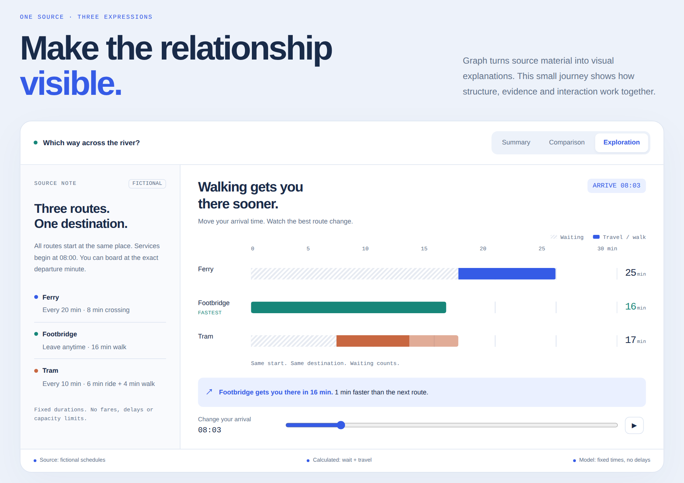

# graph

**English** · [中文](README.zh-CN.md)

Turn an article, video, paper, report, or dataset into a visual HTML explainer that helps readers understand and explore the source material.

Graph adapts the language, structure, and visual expression to the material. A mechanism may benefit from an interactive comparison; an interview may need to preserve differing viewpoints; a personal account may be best organized around observations and experiences. It preserves important evidence and uncertainty without forcing every subject into the same layout.

## See Graph in action

**[Inside Graph: make the relationship visible](https://lab.ruifengc.com/graph/inside-graph/)** explains the skill’s design through a fictional journey. Switch between a summary, a shared comparison and an interactive model. Change your arrival time to see waiting times, route totals and the recommendation update together.

[](https://lab.ruifengc.com/graph/inside-graph/)

**[Explore the demo →](https://lab.ruifengc.com/graph/inside-graph/)** · English / 中文 · Light / dark

An authored demonstration built with Graph, using fictional routes and timings. [Source and assumptions](docs/demo/source.md) · [Page source](docs/demo/index.html).

## Installation

Copy this prompt into your agent:

```text
Install the graph skill from https://github.com/ruifengc/graph.
Use the skill installation method supported by your agent and environment,
preferably at user scope. Include the supporting directories alongside SKILL.md.
If graph is already installed, update it while preserving local changes.
After installation, confirm the location and explain how to start using it,
including whether a new session is needed.
```

Your agent needs network access and permission to install skills in your environment.

## Usage

Once installed, ask your agent:

```text
Explain this article as a visual page: <URL or text>
Turn this video into a visual guide: <URL or transcript>
Explain this paper's method, results, and limitations: <PDF or link>
Make an explainer from this dataset: <file>
```

The agent needs suitable tools to retrieve or transcribe source material. It should state meaningful gaps in the material it can access.

The page uses interaction when it helps explain the content, keeps visualizations and explanations consistent, and offers light and dark themes when appropriate for interactive reading. It distinguishes source claims, interpretation, teaching assumptions, and uncertainty.

`workflows/` and `references/` provide optional guidance for specific inputs and design problems. `scripts/` contains optional document checks, a browser smoke check, and packaging and preview helpers. Run the helper checks with `python3 -m unittest discover -s tests -v`. Automated checks do not verify factual accuracy or page-specific interaction behavior.

## License

MIT © 2026 ruifengchen
