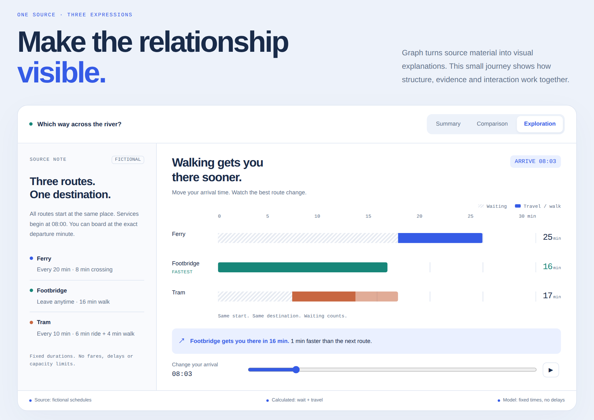

# graph

[English](README.md) · **中文**

把文章、视频、论文、报告或数据集做成可视化 HTML 讲解页，帮助读者理解和探索原有内容。

Graph 根据材料选择语言、结构与视觉表达：机制可以通过交互比较来讲解，访谈可能需要保留不同观点，个人记录则可以围绕观察和经历展开。页面保留重要证据和不确定性，不强求所有内容使用相同布局。

## 看看 Graph 如何讲解

**[Inside Graph：让关系看得见](https://lab.ruifengc.com/graph/inside-graph/)** 用一段虚构的过河旅程解释这个 skill 的设计。在摘要、共用尺度的比较和交互模型之间切换；改变到达时刻，观察等待时间、总耗时和路线建议如何同步变化。

[](https://lab.ruifengc.com/graph/inside-graph/)

**[打开交互演示 →](https://lab.ruifengc.com/graph/inside-graph/)** · 中文 / English · 浅色 / 深色

这是用 Graph 制作的教学演示，路线与时刻均为虚构。[材料与假设](docs/demo/source.md) · [页面源码](docs/demo/index.html)。

## 安装

把下面这段话复制给你的 agent：

```text
请帮我安装 graph skill，仓库地址：https://github.com/ruifengc/graph。
请使用你当前 agent 和环境支持的 skill 安装方式，优先安装到用户级目录，
并保留 SKILL.md 及配套目录的完整结构。
如果已经安装，请在保留本地修改的前提下更新。
完成后告诉我安装位置、如何开始使用，以及是否需要开启新会话。
```

agent 需要能访问网络，并有权限在当前环境中安装 skill。

## 使用

安装后，向 agent 提出任务：

```text
把这篇文章做成可视化讲解页：<链接或正文>
把这个视频整理成可视化讲解页：<链接或文字稿>
解释这篇论文的方法、结果和局限：<PDF 或链接>
根据这份数据做一个讲解页：<文件>
```

agent 需要相应的工具读取或转写材料；无法取得的重要内容应说明范围。

页面在有助于理解时加入交互，保持图形和说明一致；适合交互阅读时提供浅色和深色主题。原文主张、整理者解释、教学假设和不确定性应清楚区分。

`workflows/` 和 `references/` 提供针对不同材料和设计问题的按需说明；`scripts/` 提供可选的文档检查、浏览器冒烟检查、打包及预览工具。可运行 `python3 -m unittest discover -s tests -v` 检查辅助脚本。自动检查不能证明事实准确，也不能代替页面交互检查。

## 协议

MIT © 2026 ruifengchen
